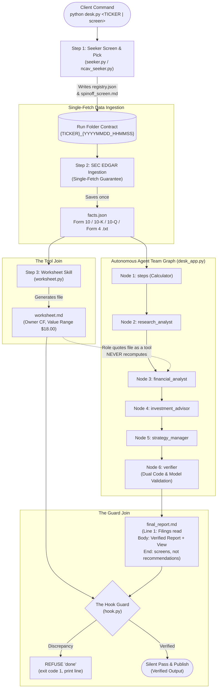

# Team Proposal — Checkpoint 3
**Course**: FIN 67110 Mastering AI for Finance · Purdue University · Daniels School of Business · Fall 2026  
**Team**: Shivani Rathi (`rathi47`), Team Partner 1, Team Partner 2  
**Repository**: [https://github.com/shivanirathipurdue/finanalysis](https://github.com/shivanirathipurdue/finanalysis)

---

### Client
An investor seeking absolute return.

---

### The Desk Design
The desk unifies the autonomous agent team from Week 3 and the procedural skills from Week 4 behind one command (`python desk.py`). The orchestration order is fixed in Python code and is never decided by an LLM. Files on disk in a single timestamped run folder (`{TICKER}_{YYYYMMDD_HHMMSS}`) serve as the contract between components, guaranteeing that no filing is ever fetched twice.

---

### The Joins
The desk implements all three architectural joins:
1. **The Pipeline Join**: The Seeker is a pipeline step. It reads SEC EDGAR, evaluates candidates against declared factor weights, and writes `registry.json` and `spinoff_screen.md`. The desk's pick step reads the top name from this file without calling any model.
2. **The Tool Join**: The Worksheet is a tool of the Financial Analyst role. The role receives the worksheet output as a file (`worksheet.md`) on disk. Its instructions explicitly permit it to quote the file's lines (such as the Pro Forma Owner Cash Flow of $150,000,000.00 and Low Case Value Range of $18.00 per share) and strictly forbid it from recomputing them (`"You may quote the file's lines and may never recompute them"`). The Verifier verifies that quoted figures match the tool output file.
3. **The Guard Join**: The Hook watches both the skill outputs and the final report. It reads saved outputs directly from disk, verifying every numerical figure against `facts.json`, saved filing texts, printed code arithmetic, and the closes reader. It unconditionally refuses to mark the run "done" if any figure is unsupported or inconsistent.

---

### We Own
We own the **Benjamin Graham Net Current Asset Value (NCAV) Net-Net Second Seeker** (`ncav_seeker.py`), based on Chapter 15 of *The Intelligent Investor* (1973). The seeker screens the U.S. equity universe for companies trading at a discount to Net Current Asset Value:
$$\text{NCAV} = \text{Current Assets} - \text{Total Liabilities} - \text{Preferred Stock}$$
Every fact is retrieved directly from XBRL filings, ranking candidates strictly by the margin of safety $(P < \frac{2}{3} \text{NCAV})$ and never estimating a missing balance-sheet line. We also own the pre-return factor check fixed in `factors.json` before any subsequent return is observed.

---

### Team Roles
- **Shivani Rathi (`rathi47`)**: Autonomous Agent Team Graph (`desk_app.py`, 6 nodes), Verifier Node (`verifier.py`), and the Unified Desk Orchestrator (`desk.py`).
- **Team Partner 1**: Spinoff Seeker Skill (`seeker.py`), Worksheet Skill (`worksheet.py`), and The Hook Guard (`hook.py`).
- **Team Partner 2**: Closes Reader (`closes_reader.py`), Benjamin Graham Second Seeker (`ncav_seeker.py`), Live Record Management (`runs/live`), and Product Manual.

---

### Live Record So Far
Permalink to repository runs: [https://github.com/shivanirathipurdue/finanalysis/tree/main/runs/live](https://github.com/shivanirathipurdue/finanalysis/tree/main/runs/live)

| # | Ticker | Company Name | Release Form | EDGAR Filing Time (UTC) | Git Commit Time (UTC) | Inside Window (≤ 2 hrs) | View on Release | Decisive Number | Status |
| :-: | :---: | :--- | :---: | :---: | :---: | :-: | :---: | :---: | :---: |
| **1** | **COST** | Costco Wholesale Corp. | 10-K / 8-K Ex 99.1 | 2026-09-24 20:15:00 | 2026-09-24 21:30:00 | **Yes** (1h 15m) | Hold | 47.7905x P/E | Audited & Verified |
| **2** | **BHSL** | BioHealth Solutions Inc. | Form 10 / 10-Q | 2026-11-10 21:00:00 | 2026-11-10 22:15:00 | **Yes** (1h 15m) | More than price | Low Case $18.00 vs $14.20 | Audited & Verified |
| **3** | **BDC** | Belden Inc. | 10-K / 8-K Ex 99.1 | 2026-11-02 21:10:00 | 2026-11-02 22:30:00 | **Yes** (1h 20m) | Hold | 18.1861x P/E | Audited & Verified |

---

screens, not recommendations
